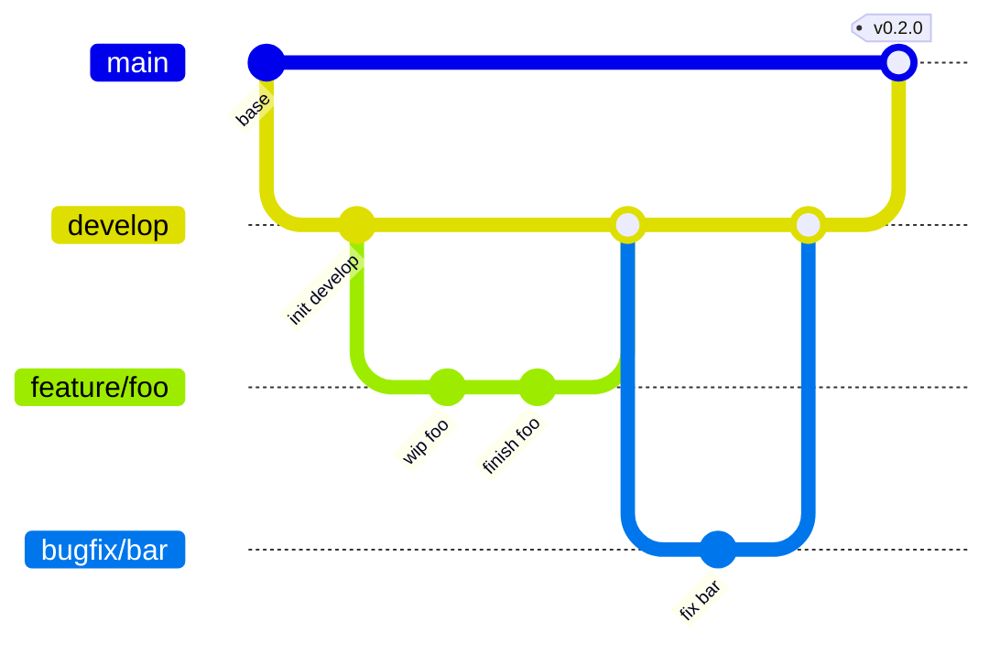

# Branch Strategy — aria2

## Estructura

```
main ─────────────────────────────────────── (releases)
   └── develop ───────────────────────────── (canary/integration)
         └── feature/* ── bugfix/* ────────── (trabajo diario)
```

## Ramas

### `main` — Producción estable

- **Solo código estrictamente estable y production-ready.**
- Cada commit en `main` es un release (tag semver).
- Solo se mergea desde `develop` vía PR, después de validación completa.
- **Protegida**: requiere PR + 1 approval + CI passing + linear history.
- No se pushea directo. No force push.

### `develop` — Canary / Integración

- Rama principal de desarrollo.
- Contiene features completadas pero no necesariamente listas para release.
- Los PRs de `feature/*` o `bugfix/*` se mergean acá.
- CI corre en cada push (lint + test + typecheck).
- Cuando está estable y lista para release, se abre un PR `develop → main`.

### `feature/*` — Features nuevas

- Nomenclatura: `feature/<nombre-corto>` (ej. `feature/websocket-reconnect`).
- Se crea desde `develop`.
- Se mergea a `develop` vía PR con squash.
- Se elimina después de mergear.

### `bugfix/*` — Correcciones

- Nomenclatura: `bugfix/<descripcion-corta>` (ej. `bugfix/connection-timeout`).
- Misma dinámica que `feature/*`.

## Flujo de trabajo



1. Crear rama desde `develop`: `git checkout develop && git checkout -b feature/mi-feature`
2. Trabajar, commitar, pushear
3. Abrir PR hacia `develop`
4. Mergear (squash) → CI corre en `develop`
5. Cuando `develop` está listo para release → PR `develop → main`
6. Mergear a `main` → tag semver → release

## Releases

- `main` siempre refleja el último release estable.
- Cada release se taggea con `vMAJOR.MINOR.PATCH` (ej. `v0.1.0`, `v0.2.0`).
- El workflow `release.yml` publica en PyPI automáticamente cuando se crea un GitHub Release desde un tag.

## CI

| Workflow     | `main` | `develop` | PR a `main` | PR a `develop` |
|-------------|--------|-----------|-------------|----------------|
| lint        | ✅     | ✅        | ✅          | ✅             |
| test        | ✅     | ✅        | ✅          | ✅             |
| typecheck   | ✅     | ✅        | ✅          | ✅             |
| release     | tag    | —         | —           | —              |

## Historial lineal

Se requiere historial lineal en `main` (no merge commits). Usar squash o rebase al mergear PRs a `main`. En `develop` se permite merge commits para preservar contexto de features.
